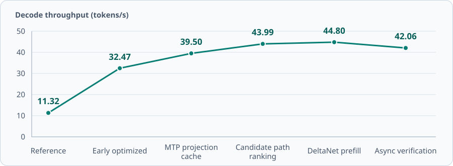

<p align="center">
  
</p>
<h1 align="center">UltraRun</h1>
<p align="center">Local BF16 inference on Apple Silicon</p>
<p align="center">
  <a href="README.md" lang="en" aria-current="page"><kbd><strong>English</strong></kbd></a> ·
  <a href="README.zh-CN.md" lang="zh-CN"><kbd>中文</kbd></a>
  &nbsp;|&nbsp;
  <a href="#performance">Performance</a> ·
  <a href="#quick-start">Quick start</a>
</p>

Run the original [Qwen3.8-27B BF16](https://huggingface.co/Qwen/Qwen3.8-27B/tree/37561816e66b5b9153b1b64c10968c18c1e6f4a0) safetensors weights with MLX and custom Metal kernels. UltraRun streams chat responses in the browser and terminal.

**M2 Ultra · 4,096 uncached input tokens · 11.42 s to first token · 50.85 tokens/s streaming decode.**

## Performance

### 4K prefill

The optimized profile on Apple M2 Ultra with MLX 0.32.4 uses grouped FFN projections, fused DeltaNet prefill, and batched submission of the existing 512-token full-attention blocks. Gate/up and DeltaNet input projections use lossless operand conversion where the runtime can recover the original BF16 values. MTP prompt priming writes only the K/V cache needed by subsequent drafts.

| Measurement | Result |
| --- | ---: |
| Target prefill, per-block vs. per-layer attention submission | 11.61 → **11.29 s** (2.8% lower) |
| MTP prompt priming, full draft vs. K/V-only | 74.0 → **67.1 ms** |
| Time to first token, complete streaming request | **11.42 s** |
| Streaming decode throughput | **50.85 tokens/s** |
| Peak MLX memory for the streaming request | **41.63 GiB** |

The streaming request used a Chinese technical-report prompt, 4,096 uncached input tokens, and 1,024 output tokens. The BF16 target and native MTP were resident, the hardware reported `nominal` thermal state, and the request limit was 45.79 GiB. Swap reads and writes were zero. A separate run at `fair` reached 11.45 s to first token and 50.88 tokens/s. Both streams matched all 1,024 reference tokens.

The attention A/B used the same resident model and prompt in A/B/B/A order. Prompt hidden states, target and MTP caches, and the first token matched bit for bit. Target prefill is timed separately from MTP priming and first-token scoring.

### Code completion throughput



Each point shows a historical HTTP measurement on M2 Ultra with the same code workload and 4,096 input / 1,024 output tokens. In one A/B run, the reference and early optimized profiles reached 11.32 and 32.47 tokens/s, a **2.87× speedup**. The output hashes differed. Later measurements came from separate runs under varying thermal conditions.

### HTTP and streaming chat

| Workload | Input tokens | Output tokens | Decode (tokens/s) | Time to first token | Verification rounds |
| --- | ---: | ---: | ---: | ---: | ---: |
| HTTP · Chinese technical report | 4,096 | 1,024 | 51.31 | 13.17 s | 213 |
| HTTP · Code completion | 4,096 | 1,024 | 44.80 | 13.49 s | 241 |
| HTTP · English technical tutorial | 4,096 | 1,024 | 38.26 | 14.50 s | 271 |
| Streaming chat · First turn in Chinese | 4,096 | 1,024 | **51.63** | — | 213 |
| Streaming chat · Follow-up with 5,119 reused input tokens | 5,140 | — | — | **0.45 s** | — |

Decode throughput measures generation after the first token. The three HTTP workloads were measured together, with a peak of **41.50 GiB** and a `fair` thermal state throughout. The chat results came from a separate session. See the [benchmark archive (Chinese)](https://github.com/gklab/UltraRun/blob/52888611824d34b4b2f030ef74c414b7bd10f532/README.md#性能基准) and the [streaming chat measurements (Chinese)](https://github.com/gklab/UltraRun/blob/52888611824d34b4b2f030ef74c414b7bd10f532/README.md#L45).

## Quick start

Requires Apple Silicon, ARM64 Python 3.13, about 56 GB of disk space for the download, and sufficient unified memory to run the model.

```sh
uv venv --python 3.13 .venv
uv pip install --python .venv/bin/python -r requirements.txt
.venv/bin/python scripts/download.py
.venv/bin/python -m ultrarun.server --port 8765 --profile optimized --draft-schedule frontier_prefetch
```

The downloader supports resuming and checks all 18 weight shards against the SHA-256 manifest. To download the weight shards from ModelScope, run `.venv/bin/python scripts/download.py --source modelscope`.

Open the [local chat page](http://127.0.0.1:8765/) or run `.venv/bin/python -m scripts.chat` in another terminal. Both clients stream through `/chat` and can reuse a matching prefix from the most recent conversation.

| Endpoint | Purpose |
| --- | --- |
| `GET /healthz` | Check readiness, the inference profile, and the default draft schedule |
| `POST /generate` | Send `{"prompt":"Hello","max_tokens":128}` to receive the full text and metrics |
| `POST /chat` | Run multi-turn chat. With `stream: true`, receive text deltas and final metrics as NDJSON |

The optimized profile uses native MTP to draft candidates and the BF16 target model's full vocabulary to verify them. It uses `frontier_prefetch` when the runtime conditions are met. Check `metrics.draft_schedule` for the schedule used. To select the reference profile, pass `--profile reference`. Use `--memory-gib` and `--cache-gib` to set unified memory budgets. The working-set limit is capped by device capacity and Metal's recommended limit.

## Run benchmarks locally

Stop the service before benchmarking. Both acquire the same Metal workspace lock.

```sh
.venv/bin/python -m ultrarun.cli verify-kernel
.venv/bin/python -m ultrarun.cli verify-model
.venv/bin/python -m ultrarun.cli bench --runs 3 --jsonl runs/baseline.jsonl
.venv/bin/python scripts/tune.py baseline frontierprefetch11 fastprefill11
```

The CLI benchmark uses the first 4,096 tokens of Python's standard-library `inspect.py` by default and generates 1,024 tokens. Use `--prompt-file` to supply another input. Results include decode throughput, end-to-end throughput, time to first token, peak memory, and the output token hash.
