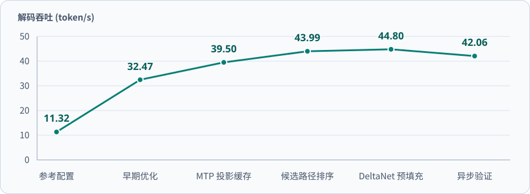

<p align="center">
  
</p>
<h1 align="center">UltraRun</h1>
<p align="center">面向 Apple Silicon 的本地 BF16 推理引擎</p>
<p align="center">
  <a href="README.md" lang="en"><kbd>English</kbd></a> ·
  <a href="README.zh-CN.md" lang="zh-CN" aria-current="page"><kbd><strong>中文</strong></kbd></a>
  &nbsp;|&nbsp;
  <a href="#性能">性能</a> ·
  <a href="#快速开始">快速开始</a>
</p>

直接加载 [Qwen3.8-27B BF16](https://huggingface.co/Qwen/Qwen3.8-27B/tree/37561816e66b5b9153b1b64c10968c18c1e6f4a0) 原版 safetensors 权重，通过 MLX 和自定义 Metal 内核进行推理，支持网页和终端流式聊天。

**M2 Ultra 实测，4096 个无缓存输入 token，11.42 秒出首 token，流式解码 50.85 token/s。**

## 性能

### 4K 预填充

M2 Ultra 上的优化配置使用 MLX 0.32.4，对 FFN 投影分组，融合 DeltaNet 预填充算子，并将全注意力原有的 512-token 分块按层合并提交。Gate/up 和 DeltaNet 输入投影仅在可以精确恢复原 BF16 值时使用无损操作数转换。MTP 提示词预热只写入后续草拟需要的 K/V 缓存。

| 指标 | 结果 |
| --- | ---: |
| 主模型预填充，全注意力逐块提交与按层提交对照 | 11.61 → **11.29 秒**（耗时降低 2.8%） |
| MTP 预热，完整草拟与仅写 K/V 对照 | 74.0 → **67.1 毫秒** |
| 完整流式请求的首 token 延迟 | **11.42 秒** |
| 流式解码吞吐 | **50.85 token/s** |
| 流式请求的 MLX 内存峰值 | **41.63 GiB** |

流式请求使用中文技术报告提示词，输入 4096 个无缓存 token，输出 1024 个 token。原版 BF16 主模型和原生 MTP 均已驻留，设备热状态为 `nominal`，请求内存上限为 45.79 GiB，swap 读写均为零。另一轮在 `fair` 状态下测得首 token 延迟 11.45 秒、解码 50.88 token/s。两轮流式回归的 1024 个输出 token 均与基准一致。

注意力 A/B 共用同一模型和提示词，按 A/B/B/A 顺序测试。提示词隐藏状态、主模型和 MTP 缓存及首 token 均逐位一致。主模型预填充单独计时，MTP 预热和首 token 打分计入首 token 延迟。

### 代码续写的解码吞吐



各点为 M2 Ultra 上同一代码负载（4096 输入 / 1024 输出）的历史 HTTP 实测。参考配置与早期优化配置在同一轮对照中达到 11.32 和 32.47 token/s，提升 **2.87×**，两者的输出哈希有差异。后续点来自不同轮次，硬件热状态也有变化。

### HTTP 与流式聊天实测

| 场景 | 输入 token | 输出 token | 解码 token/s | 首 token | 验证轮数 |
| --- | ---: | ---: | ---: | ---: | ---: |
| HTTP · 中文技术报告 | 4096 | 1024 | 51.31 | 13.17 s | 213 |
| HTTP · 代码续写 | 4096 | 1024 | 44.80 | 13.49 s | 241 |
| HTTP · 英文技术教程 | 4096 | 1024 | 38.26 | 14.50 s | 271 |
| 流式聊天 · 中文首轮 | 4096 | 1024 | **51.63** | — | 213 |
| 流式聊天 · 紧接一轮，复用 5119 个输入 token | 5140 | — | — | **0.45 s** | — |

解码吞吐从首 token 发出后开始计时。表中前三项来自同一批 HTTP 复测，请求峰值为 **41.50 GiB**，全程处于 `fair` 热状态。后两项来自另一轮流式会话实测。图表数据和口径可查阅[性能实验归档](https://github.com/gklab/UltraRun/blob/52888611824d34b4b2f030ef74c414b7bd10f532/README.md#性能基准)。流式会话数据见[原始记录](https://github.com/gklab/UltraRun/blob/52888611824d34b4b2f030ef74c414b7bd10f532/README.md#L45)。

## 快速开始

需要 Apple Silicon、ARM64 Python 3.13 和约 56 GB 下载空间，运行还需要足够的统一内存。

```sh
uv venv --python 3.13 .venv
uv pip install --python .venv/bin/python -r requirements.txt
.venv/bin/python scripts/download.py
.venv/bin/python -m ultrarun.server --port 8765 --profile optimized --draft-schedule frontier_prefetch
```

下载支持断点续传，18 个权重分片均按 SHA-256 清单校验。可用 `scripts/download.py --source modelscope` 从 ModelScope 下载权重分片。

打开[本地聊天网页](http://127.0.0.1:8765/)，或另开终端运行 `.venv/bin/python -m scripts.chat`。两端通过 `/chat` 流式输出，并复用最近一个会话的匹配前缀。

| 入口 | 用途 |
| --- | --- |
| `GET /healthz` | 查看就绪状态、推理配置和默认草拟调度 |
| `POST /generate` | 输入 `{"prompt":"你好","max_tokens":128}`，一次性返回文本和指标 |
| `POST /chat` | 多轮聊天，`stream: true` 时以 NDJSON 返回增量文本和最终指标 |

优化配置使用模型原生 MTP 草拟，由 BF16 主模型在完整词表上验证。`frontier_prefetch` 在满足运行条件时启用，`metrics.draft_schedule` 显示实际调度。参考配置使用 `--profile reference`。统一内存预算由 `--memory-gib` 和 `--cache-gib` 控制，工作集上限还受设备容量与 Metal 建议值约束。

## 本地复测

退出服务后运行基准，服务和基准共用 Metal 工作区锁。

```sh
.venv/bin/python -m ultrarun.cli verify-kernel
.venv/bin/python -m ultrarun.cli verify-model
.venv/bin/python -m ultrarun.cli bench --runs 3 --jsonl runs/baseline.jsonl
.venv/bin/python scripts/tune.py baseline frontierprefetch11 fastprefill11
```

CLI 基准默认用 Python 标准库 `inspect.py` 的前 4096 个 token 做续写，生成 1024 个 token。可通过 `--prompt-file` 指定输入。结果包含解码吞吐、端到端吞吐、首 token 延迟、内存峰值和输出 token 哈希。
